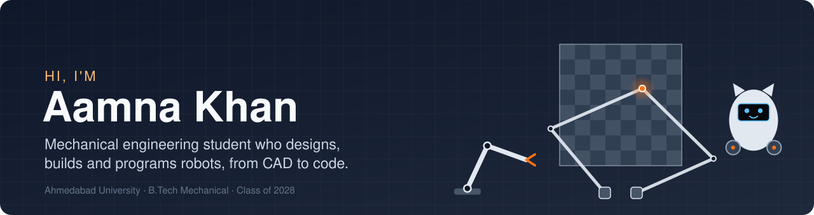
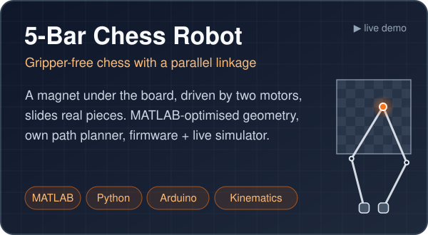
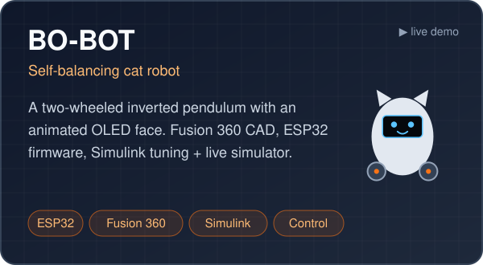
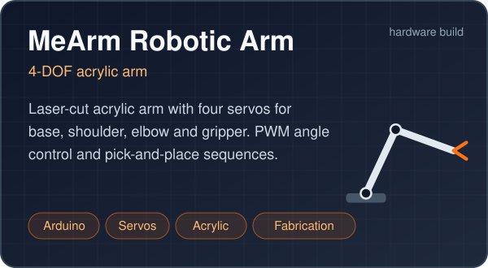
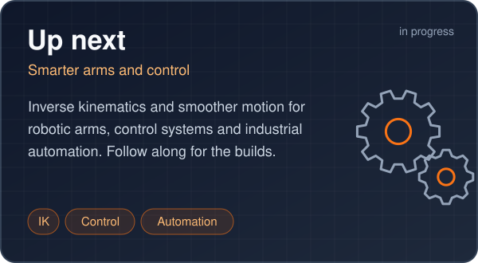

  

  
  

I'm a Mechanical Engineering student at **Ahmedabad University** (Class of 2028). I like taking a robot through every stage: sketch → CAD → analysis → fabrication → electronics → code → a working machine. Every project here has its design files, maths, firmware and build photos, and some have a simulator you can try in your browser.

## 🤖 Projects

<table>
<tr>
<td width="50%" valign="top">

<a href="https://aamna-builds.github.io/5bar-chess-robot/"><b>▶ Play against it</b></a> · <a href="https://github.com/aamna-builds/5bar-chess-robot">Repository</a>

</td>
<td width="50%" valign="top">

<a href="https://aamna-builds.github.io/Bo-Bot/"><b>▶ Try the simulator</b></a> · <a href="https://github.com/aamna-builds/Bo-Bot">Repository</a>

</td>
</tr>
<tr>
<td width="50%" valign="top">

<a href="https://github.com/aamna-builds/mearm-robotic-arm">Repository</a>

</td>
<td width="50%" valign="top">

Robotic arm development · control systems · industrial automation

</td>
</tr>
</table>

## 🛠️ Toolbox

**Design & analysis** 

**Code** 

**Electronics** 

**Fabrication** 

## 🔭 Right now

- 🦾 Adding inverse kinematics and smoother motion to robotic arms
- 🎛️ Learning control systems through BO-BOT's balance controller
- 🏭 Exploring industrial automation
- ♟️ Next for the 5-bar chess robot: v2 hardware with the optimised link lengths
